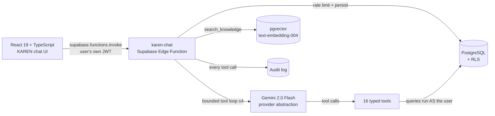

# KAREN: Knowledge & Academic Reporting Engine

**A role-aware AI assistant built into a college management system.** Students, faculty and admins ask questions in plain English ("What's my attendance in DBMS?", "Which students left class early today?"), and KAREN answers using live campus data, but only data the asking user is allowed to see.

KAREN sits on top of **CIMS** (College Intelligent Management System), a full campus platform covering academic structure, timetables, geofenced attendance, early-exit monitoring, notifications, documents and reports.

---

## Architecture



## How KAREN works
- **The model never sits in the browser.** The UI calls a single Edge Function. No AI SDK and no API key ever reach the client.
- **Authorization uses the database itself.** Every tool query runs as the calling user (their own JWT, never the service role), so Postgres **Row-Level Security** is the real permission boundary. The AI cannot bypass access control.
- **Tool calling:** 16 typed tools covering attendance, timetables, student profiles, geofence status, exit events, notifications, documents and reports. Inputs are validated with Zod. The loop is capped at 4 iterations, so KAREN always terminates.
- **RAG:** the `search_knowledge` tool retrieves from a pgvector knowledge base embedded with Google `text-embedding-004`.
- **Human-in-the-loop:** write actions such as notifying a student go through a confirmation flow before they run.
- **Observability:** every tool call is audited, with per-user rate limiting and request timeouts.
- **Provider abstraction:** use `gemini`, or a deterministic `fixture` provider for tests. A missing key returns a typed `PROVIDER_NOT_CONFIGURED` error instead of a made-up answer.

## The CIMS platform
| Module | What it does |
|---|---|
| Academic structure | Departments, programs, classes and faculty, with HOD roles |
| Timetable & classrooms | Sessions mapped to classrooms with coordinates |
| Geofenced attendance | Attendance engine backed by classroom geofences (GeoJSON) |
| Early-exit monitoring | Detects and records students leaving a session early |
| Notifications | Notification engine with role-scoped delivery |
| Documents & reports | Generated documents and reporting views |
| Audit | Database-level audit trail |

The database is defined in **27 versioned SQL migrations**, covering identity and roles, authorization functions, RLS policies, auth hardening, and the KAREN core, RAG, confirmation and observability tables.

## Tech stack
**Frontend:** React 19 · TypeScript · Vite · Tailwind · React Router
**Backend:** Supabase (PostgreSQL, Auth, Storage, Realtime, Edge Functions on Deno)
**AI:** Gemini 2.0 Flash · text-embedding-004 · pgvector · function/tool calling · Zod
**Quality:** Vitest · Supabase DB tests · GitHub Actions CI

## Run locally
```bash
npm install
cp .env.example .env          # add your Supabase keys after db:start
npm run db:start              # local Supabase stack (Docker)
npm run db:reset              # apply migrations + seed data
npm run db:types              # generate typed DB client
npm run dev
```
To enable the live model, set `KAREN_PROVIDER=gemini` and `KAREN_API_KEY` as Edge Function secrets. Without them, KAREN runs on the deterministic fixture provider.

## Docs
Design documents (PRD, API detail, architecture decision records, testing and acceptance criteria) are in [`docs/`](docs).

---
Built by **Tharun DV** · [LinkedIn](https://www.linkedin.com/in/tharun-dv-76949a349) · [GitHub](https://github.com/Nexus-Thoughts)
