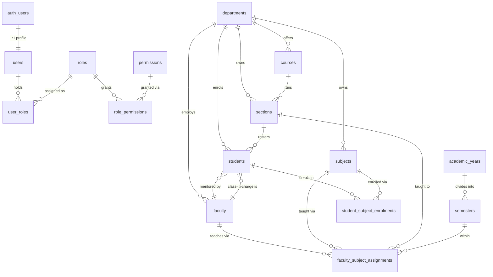

# 20 — Database Schema Detail

`docs/03_DATABASE_SCHEMA.md` names 25 tables with no column-level detail
(docs/00_RECONNAISSANCE.md §12). This document is the actual, binding
column-level schema for every table that has landed so far. It is updated as
each later phase adds tables. The table names from docs/03 are treated as
mandatory; where a name here differs slightly (e.g. `role_permissions` vs.
`permissions`) it is because docs/03 named the concept and this document
supplies the join table docs/03 implied but didn't spell out.

Source of truth for the actual DDL: `supabase/migrations/*.sql`. If this
document and a migration ever disagree, the migration is correct and this
document has drifted — treat that as a bug.

Conventions applied to every table unless noted otherwise:
- `id uuid primary key default extensions.gen_random_uuid()`
- `created_at timestamptz not null default now()`, `updated_at` maintained by
  `cims.set_updated_at()` trigger (server-owned, never client-settable)
- RLS is enabled on every table in `public`; no table is left open
- Regulated tables carry `cims.audit_row_change()` — see the Audit column below

---

## Schema map

---

## Migration `20260101000100_extensions_and_conventions`

Extensions: `postgis`, `pgcrypto`, `pg_trgm`, `btree_gist`, `vector` (all in
schema `extensions`). Private schema `cims` (not in PostgREST's exposed
schema list — unreachable over HTTP even if a policy were misconfigured).

Functions: `cims.set_updated_at()`, `cims.reject_mutation()` — conventions
used by every later migration.

---

## GRANT layer (migration `20260101000700_rls_policies`, applied before any policy)

RLS restricts *which* rows a role sees; it does not by itself grant a role
any access to a table at all — that is a separate `GRANT`, and this local
Postgres image does not extend one to `authenticated` automatically. See
ADR-008 (docs/22) for how this was found (every RLS policy was dead code
until this landed). The migration therefore opens with:

- `authenticated`: `SELECT, INSERT, UPDATE, DELETE` on every table in this
  document except `audit_logs`, which is `SELECT`-only (writes happen solely
  through `cims.write_audit()`, `SECURITY DEFINER`).
- `service_role`: `ALL`, per Supabase convention — it bypasses RLS and is
  used only by Edge Functions/CI, never the browser.
- `ALTER DEFAULT PRIVILEGES` extends the same two grants to every table a
  later migration adds, so this does not need repeating per phase.
- `anon`: explicitly revoked from everything, belt-and-braces on top of RLS
  (`revoke all on all tables in schema public from anon`, plus the matching
  default-privilege revoke) — confirmed by pgTAP: `anon` gets a hard
  `permission denied` (SQLSTATE 42501), not merely an RLS-filtered empty
  result.

---

## `public.audit_logs`

**Purpose.** Immutable, hash-chained audit trail for every regulated write
and every privileged read (docs/49, docs/13).

| Column | Type | Null | Notes |
|---|---|---|---|
| id | bigint identity | no | PK |
| occurred_at | timestamptz | no | default now() |
| actor_id | uuid → auth.users(id) | yes | `on delete set null` — history outlives the actor |
| actor_role | text | yes | JWT role claim at write time |
| actor_ip | inet | yes | reserved for API-layer population |
| request_id | uuid | yes | correlates all rows from one API call / KAREN turn |
| action | audit_action enum | no | INSERT/UPDATE/DELETE/LOGIN/LOGOUT/PERMISSION_DENIED/EXPORT/GENERATE/AI_TOOL_CALL/AI_WRITE_ACTION/PRIVILEGED_READ |
| entity_type | text | no | table/resource name |
| entity_id | text | yes | |
| old_values / new_values | jsonb | yes | UPDATE stores a `{key: {from,to}}` diff, not full rows |
| reason | text | yes | e.g. attendance override justification |
| metadata | jsonb | no | default `{}` |
| previous_hash / row_hash | text | row_hash not null | sha256 chain, see below |

**Primary key.** `id`. **Foreign keys.** `actor_id → auth.users`.
**Indexes.** `occurred_at desc`; `(actor_id, occurred_at desc)`;
`(entity_type, entity_id, occurred_at desc)`; `(action, occurred_at desc)`;
partial index on `request_id`.

**RLS.** `audit_logs_select`: requires `audit.read` **and** (`is_admin()` OR
`actor_id = auth.uid()` OR the actor's profile is one the reader could
already read). No INSERT/UPDATE/DELETE policy exists at all — rows arrive
only through the `cims.write_audit()` SECURITY DEFINER function, and
`cims.reject_mutation()` triggers block UPDATE/DELETE unconditionally, so
even a service-role connection cannot amend history through ordinary SQL
without dropping the trigger first (a schema change that is itself audited
by migration review).

**Audit.** This *is* the audit table; it does not audit itself beyond the
hash chain (`cims.audit_hash_chain()` trigger, `cims.verify_audit_chain()`
for verification, exposed to the Audit Reports module in Phase 12).

---

## `public.users`

**Purpose.** Profile projection of `auth.users`. Holds zero credential
material — Supabase Auth owns passwords/sessions entirely.

| Column | Type | Null | Notes |
|---|---|---|---|
| id | uuid → auth.users(id) | no | PK, `on delete cascade` |
| email | citext | yes | |
| full_name | text | no | `check (length(btrim(...)) > 0)` |
| phone | text | yes | shape-checked |
| status | user_status enum | no | ACTIVE / INACTIVE / SUSPENDED, default ACTIVE |
| must_change_password | boolean | no | default false; set true by admin provisioning, cleared only via `public.complete_password_change()` (20260101000800) |
| last_login_at | timestamptz | yes | |

**Indexes.** partial `status = 'ACTIVE'`; trigram GIN on `full_name`.
**RLS.** `users_select_self` (own row); `users_select_in_scope` (requires
`users.read` and the target being a student/faculty the reader can already
reach); `users_update_self` (own row, `WITH CHECK (id = auth.uid())` pins
identity); `users_write_admin` (full CRUD, requires `users.write`).
**Column-level guard beyond RLS.** `cims.restrict_self_user_update()`
(BEFORE UPDATE trigger, 20260101000800) confines a self-edit lacking
`users.write` to `full_name`/`phone` — RLS alone is row-scoped and cannot
express this; see ADR-009. `status`/`email`/`created_at`/`must_change_password`
snap back to their stored value on such an update.
**Audit.** `users_audit` on INSERT/UPDATE/DELETE.
**Trigger.** `on_auth_user_created` on `auth.users` auto-provisions the
matching `public.users` row via `cims.handle_new_auth_user()`.

---

## `public.roles` / `public.permissions` / `public.role_permissions`

**Purpose.** Fixed role catalogue, capability catalogue, and the default
grants between them (docs/04).

`roles`: `key` (role_key enum, unique), `name`, `description`,
`default_scope` (scope_kind enum), `rank` (unique, lower binds tighter — used
by `primaryRole()` on the frontend to pick a display role).

`permissions`: `key` (unique, `check (key = resource || '.' || action)`),
`resource`, `action`, `description`, `is_sensitive boolean`.

`role_permissions`: composite PK `(role_id, permission_id)`.

**RLS.** All three: readable by any active user (`*_select`); writable only
with `permissions.manage` (`role_permissions_write`). `roles`/`permissions`
themselves have no write policy — they change only by migration, which keeps
the catalogue itself out of runtime drift.
**Audit.** `role_permissions_audit` on INSERT/DELETE.

**Seeded grants** — full list in
`supabase/migrations/20260101000300_identity_and_roles.sql`; summarized in
docs/04 rules already, not duplicated here.

---

## `public.user_roles`

**Purpose.** The scoped role-assignment table — the actual authorization
edge. See ADR-003 (docs/22) for why this is a table, not a `role` column.

| Column | Type | Null | Notes |
|---|---|---|---|
| id | uuid | no | PK |
| user_id | uuid → users(id) cascade | no | |
| role_id | uuid → roles(id) restrict | no | |
| department_id | uuid → departments(id) cascade | yes | required iff role scope = DEPARTMENT |
| section_id | uuid → sections(id) cascade | yes | required iff role scope = SECTION |
| granted_by | uuid → users(id) set null | yes | |
| valid_from / valid_until | timestamptz | valid_from not null | `check (valid_until is null or valid_until > valid_from)` |
| status | entity_status enum | no | ACTIVE/INACTIVE/ARCHIVED |

**Constraint enforcement.** `cims.validate_role_scope()` trigger rejects any
row whose department/section shape does not match the role's
`default_scope` (e.g. an ADMIN row cannot carry a department; an HOD row
must). For SECTION-scoped roles it also back-fills `department_id` from the
section so department-level queries never need to join through sections.

**Uniqueness.** Three partial unique indexes (one per scope shape) enforce
"at most one **active** assignment per (user, role, scope)" without a single
index tripping over NULL scope columns.

**RLS.** `user_roles_select_self`; `user_roles_select_in_scope` (requires
`users.read`, department-scoped for non-admins); `user_roles_insert` /
`user_roles_update` require `roles.assign`, and a non-admin granter can only
grant **non-ADMIN** roles **inside a department they themselves hold** — this
is what stops an HOD from minting another admin or granting into a foreign
department. **No DELETE policy** — assignments are revoked via `status`, not
removed, to keep the audit trail meaningful.
**Audit.** `user_roles_audit` on INSERT/UPDATE/DELETE (grants/revocations are
always audited per docs/49).

---

## Migration `20260101000600_authorization_functions` (the `cims` kernel)

Not tables — the resolver-function layer every RLS policy and (later) every
KAREN tool calls. Documented in full in code comments; summarized here:

| Function | Returns | Purpose |
|---|---|---|
| `cims.is_active_user()` | boolean | deny-by-default gate |
| `cims.has_permission(key)` | boolean | capability check only, **no scope** |
| `cims.has_role(role)` / `is_admin()` | boolean | |
| `cims.my_role_assignments()` | setof row | live, in-window assignments |
| `cims.my_student_id()` / `my_faculty_id()` | uuid | "which record am I" |
| `cims.my_department_ids()` / `my_section_ids()` / `my_student_ids()` / `my_subject_ids()` | setof uuid | scope resolution, used in `x in (select ...)` policies |
| `cims.can_read_student(id)` / `can_write_student(id)` | boolean | convenience predicates |
| `public.my_permissions()` | table | **RPC**, effective capability list for UI affordances only |
| `public.my_profile()` | jsonb | **RPC**, single-round-trip session bootstrap consumed by `AuthProvider` |

All `cims.*` functions are `SECURITY DEFINER` + `STABLE`, granted to
`authenticated` only, and are **not** reachable over PostgREST (schema `cims`
is outside `[api].schemas`). Only `public.my_permissions()` and
`public.my_profile()` are the public surface.

---

## Academic structure — migration `20260101000400_academic_structure`

### `public.departments`
`code` (unique, shape-checked `^[A-Z0-9&_-]{2,16}$`), `name`, `status`.
RLS: readable by any active user; writable with `departments.write`
(admin-only in the seeded grants, since creating a department creates a new
scope boundary). Audited.

### `public.courses`
`department_id` (restrict), `code` (unique per department), `name`,
`duration_years` (1–8), `status`. RLS: read open; write requires
`courses.write` **and** department in the writer's `my_department_ids()`.
Audited.

### `public.academic_years` / `public.semesters`
Date-ranged (`check (end_date > start_date)`), each with at most one
`is_current = true` row enforced by a partial unique index on `(true)`. RLS:
read open; write requires `academic_terms.write`. Audited.

### `public.sections`
`(department_id, course_id, academic_year_id, name, year)` unique, `year`
1–8, `current_semester_id` (set null), `batch`, and the denormalised
**`student_count`** — kept correct by `cims.sync_section_student_count()`
firing on `students` insert/update-of-`(section_id,status)`/delete, so the
live attendance screen's "expected" count (docs/21 attendance section) never
runs a per-poll aggregate. RLS: readable if in `my_section_ids()` **or** the
section's department is in `my_department_ids()` (structural visibility —
seeing a section exists is not the same as seeing its roster, which is
governed separately by the `students` policies); write requires
`sections.write` and department scope. Audited.

### `public.faculty`
`user_id` (unique, restrict — a faculty record cannot be deleted out from
under a live account), `department_id` (home department — **not** by itself
a teaching-authorization scope, see `faculty_subject_assignments` below),
`employee_id` (unique), `designation`, `joined_on`, `status`. RLS: own row;
`faculty.read` + department scope; write requires `faculty.write` +
department scope. Audited.

### `public.students`
The core sensitive table.

| Column | Type | Null | Notes |
|---|---|---|---|
| user_id | uuid → users(id) restrict | yes | nullable — enrolled before login is provisioned |
| department_id / course_id | uuid restrict | no | |
| section_id | uuid → sections set null | yes | |
| academic_year_id | uuid restrict | no | |
| current_semester_id | uuid → semesters set null | yes | |
| register_number | text unique | no | shape-checked 3–32 chars |
| roll_number, batch | text | yes | |
| year | smallint | no | 1–8 |
| contact_email / contact_phone / guardian_name / guardian_phone | | yes | personal data — scope-gated by the same RLS as the row |
| mentor_id / class_incharge_id | uuid → faculty set null | yes | **denormalised, deliberately** — drives MENTOR scope and the docs/07 early-exit notification fan-out on a hot path |
| status | student_status enum | no | ACTIVE/ALUMNI/DROPPED/SUSPENDED/ON_LEAVE |

**Indexes.** section, department, mentor (partial), class_incharge (partial),
user (partial), status (partial, ACTIVE), trigram GIN on `register_number`.
**RLS.** `students_select_scoped`: own row via `user_id`, or (`students.read`
+ `id in my_student_ids()`). `students_insert`: `students.write` + department
scope. `students_update`: reachable via `my_student_ids()` for USING, but
`WITH CHECK` re-validates department scope so a row cannot be edited to fall
outside the writer's department. **No DELETE policy** — deactivation only.
**Audit.** full row-change audit.

### `public.subjects`
`(department_id, code)` unique, `credits` (0–20), `semester_number` (1–16),
`type` enum (THEORY/PRACTICAL/THEORY_PRACTICAL/PROJECT/ELECTIVE). RLS:
readable via `my_subject_ids()` or department scope; write requires
`subjects.write` + department scope. Audited.

### `public.faculty_subject_assignments`
**The authorization edge for FACULTY scope** (ADR-003). Unique
`(faculty_id, subject_id, section_id, semester_id)`. RLS: readable by the
assigned faculty or anyone who can read the section; write requires
`faculty.write` and department scope on the underlying section. Audited.

### `public.student_subject_enrolments`
Unique `(student_id, subject_id, semester_id)` — separate from section
membership because electives cut across sections; this is what makes
faculty-reachable-student resolution (`cims.my_student_ids()`) enrolment-based
rather than section-based, so a faculty teaching one elective cannot see the
rest of a section that didn't take it. RLS: own enrolment, or reachable via
`my_student_ids()`; write via `can_write_student()`. Audited.

---

## `public.department_stats` / `public.department_hods` (views)

**Migration.** `20260101000900_department_stats_and_hod`.
**Purpose.** Real, live counts and the resolved HOD for DepartmentsPage's
detail modal (Phase 6) — never hard-coded.

`department_stats` is `group by departments.id` over `left join`s to
`courses`/`students`/`faculty`, each count `filter (where status = 'ACTIVE')`.
`department_hods` joins `user_roles` → `roles` (key = 'HOD') → `users`,
filtered to currently-active, in-window assignments.

**`security_invoker = true` (Postgres 15+).** Both views run RLS as the
*calling* role rather than the view owner, so each joined table's own policy
(`students_select_scoped`, `faculty_select`, `user_roles_select_*`) applies
per-viewer with no extra permission logic in the view itself. Concretely: an
HOD's `department_stats` row for their own department shows a real count; the
same HOD querying another department's id still gets a row back (`departments`
is globally listable — `departments_select` has no scope predicate) but with
counts of 0, because the joined `students`/`faculty` rows are invisible to
them under RLS, not because the row is hidden. Verified in
`supabase/tests/database/004_phase6_views.test.sql` (5 assertions) —
including that this 0-vs-real-count behaviour is intentional, not a bug.

**RLS.** Views themselves carry no policies (`security_invoker` inherits
enforcement from the underlying tables); `grant select` is to `authenticated`.

---

## `public.classrooms`

**Migrations.** `20260101001000_timetable_and_classrooms`,
`20260101001200_classroom_lat_lng_columns`.
**Purpose.** A room. `location` + `radius_m` is the classroom's point+radius
geofence — the innermost of the three geofence layers (docs/05); the
campus/department polygon layers arrive in Phase 8 and are a separate model,
never merged with this one.

| Column | Type | Null | Notes |
|---|---|---|---|
| id | uuid | no | PK |
| department_id | uuid → departments | no | `on delete restrict` |
| name | text | no | unique per department, not globally |
| block, floor | text | yes | |
| capacity | integer | yes | `check (capacity is null or capacity > 0)` |
| type | classroom_type enum | no | CLASSROOM / LABORATORY / SEMINAR_HALL / AUDITORIUM / OTHER |
| status | classroom_status enum | no | ACTIVE / INACTIVE / MAINTENANCE, default ACTIVE |
| location | geography(Point,4326) | yes | write via EWKT text (`SRID=4326;POINT(lng lat)`); Postgres casts it |
| radius_m | integer | no | default 20; `check (radius_m > 0 and radius_m <= 500)` — configurable data, never a constant in application code |
| latitude, longitude | double precision | yes | generated from `location` (`ST_Y`/`ST_X`), read-only — PostgREST returns `geography` as WKB hex otherwise |

**Indexes.** `department_id`; partial `status = 'ACTIVE'`; GiST on `location`.
**RLS.** `classrooms_select` (department scope, OR used by a timetable entry
the caller can already reach); `classrooms_write` (`classrooms.write` +
department scope — ADMIN/HOD only under the current grants).
**Audit.** `classrooms_audit` on INSERT/UPDATE/DELETE (covers coordinate and
status changes — no separate "location changed" event type; the generic
row-diff audit already captures old/new `location`).

---

## `public.timetable_entries`

**Migrations.** `20260101001000_timetable_and_classrooms`,
`20260101001100_timetable_classroom_rls`.
**Purpose.** One weekly recurring slot. Conflict-free *by construction* —
see the "Conflict prevention" note below, this is not merely
application-checked.

| Column | Type | Null | Notes |
|---|---|---|---|
| id | uuid | no | PK |
| academic_year_id, semester_id, section_id, subject_id, faculty_id, classroom_id | uuid | no | all `on delete restrict` |
| day | day_of_week enum | no | MON..SUN |
| start_time, end_time | time | no | `check (end_time > start_time)` |
| time_range | int4range | no | **generated**, minutes-since-midnight; see below |
| status | entity_status enum | no | default ACTIVE |

**`time_range`.** Postgres has no built-in "time range" type, so
start/end are converted to minutes-since-midnight and expressed as an
`int4range` — the type EXCLUDE's `&&` operator can actually use. The
expression is `case when end_time > start_time then int4range(...) else null
end`, not a bare `int4range(...)` call: constructing a range with
lower > upper raises Postgres's own `22000` before the named
`timetable_valid_time` CHECK constraint ever gets to reject the row with a
clean error — found by running the test, not by reading the SQL (a NULL
range simply never matches any EXCLUDE overlap, so nothing else changes).

**Conflict prevention — three EXCLUDE constraints, not a pre-check.** A
pre-INSERT `SELECT ... WHERE overlaps` in application code has a race window:
two concurrent requests can both pass the check before either commits. These
three `EXCLUDE USING gist (... WITH =, ... WITH &&)` constraints are enforced
by Postgres itself as part of the same index structure the INSERT uses, so a
conflicting concurrent write is serialised, not merely made "less likely":
- `timetable_no_faculty_conflict` — `(faculty_id, semester_id, day)` equal + `time_range` overlapping
- `timetable_no_section_conflict` — same, on `section_id`
- `timetable_no_classroom_conflict` — same, on `classroom_id`

All three are `where (status = 'ACTIVE')` — a removed/deactivated entry
never blocks a new one from reusing its slot.

**Academic-relationship validation (`cims.validate_timetable_entry`, BEFORE
INSERT/UPDATE trigger).** The EXCLUDE constraints only see this table's own
columns; this trigger checks what they cannot: the subject belongs to the
section's department, an ACTIVE `faculty_subject_assignments` row exists for
this exact (faculty, subject, section, semester), and the classroom's
`status = 'ACTIVE'`.

**Indexes.** `(section_id, semester_id)`, `(faculty_id, semester_id)`,
`(classroom_id, semester_id)` — all partial on `status = 'ACTIVE'` — plus
`day`.
**RLS.** `timetable_select` reuses `cims.my_section_ids()` directly (ADMIN
all, HOD department, CLASS_INCHARGE own section, FACULTY assigned sections,
MENTOR mentee sections, STUDENT own section — exactly the role-scope model
this needs, already built for Phase 4) OR `faculty_id = cims.my_faculty_id()`.
`timetable_write` requires `timetable.write` + the section's department in
scope.
**Audit.** `timetable_audit` on INSERT/UPDATE/DELETE.

---

## `public.geofences` / `public.geofences_geojson` (view)

**Migrations.** `20260101001300_geofences`, `20260101001400_geofences_geojson_view`.
**Purpose.** CAMPUS (one institution-wide boundary) and DEPARTMENT/BLOCK
(department-scoped areas) polygon geofences — the two of the three
geofence layers that are NOT the classroom point+radius model (Phase 7,
`public.classrooms`). Never merged with it (docs/05).

| Column | Type | Null | Notes |
|---|---|---|---|
| id | uuid | no | PK |
| type | geofence_type enum | no | CAMPUS / DEPARTMENT / BLOCK |
| name | text | no | |
| department_id | uuid → departments | conditional | required for DEPARTMENT/BLOCK, forbidden for CAMPUS — `geofences_department_scope` CHECK |
| boundary | geography(Polygon,4326) | no | write via EWKT text; `geofences_boundary_valid` CHECK rejects a self-intersecting/invalid polygon via `ST_IsValid` |
| status | entity_status enum | no | default ACTIVE |

**Uniqueness.** At most one ACTIVE `CAMPUS` row institution-wide
(`geofences_single_active_campus_idx`); at most one ACTIVE `DEPARTMENT` row
per department (`geofences_single_active_department_idx`) — `BLOCK` is
deliberately unconstrained, since a department may have several named areas
active at once.

**`geofences_geojson`.** `security_invoker` view exposing `ST_AsGeoJSON` of
`boundary` — same reasoning as classrooms' generated lat/lng columns:
PostgREST returns `geography` as opaque WKB, which the Leaflet-based editor
cannot render. Writes still go through `geofences` directly.

**Server-side spatial functions (`SECURITY INVOKER`, `STABLE`, granted to
`authenticated`).** `public.point_in_campus(lng, lat)`,
`public.point_in_department(department_id, lng, lat)`,
`public.classroom_distance_m(classroom_id, lng, lat)` — all use
`ST_Covers`/`ST_Distance` on `geography`, so distances and containment are
real spherical measurements, not planar approximations. These are the sole
authority Phase 9/10's attendance and early-exit engines will call; the
frontend never performs its own point-in-polygon test.

**RLS.** `geofences_select` — any active user (a boundary's shape is not
sensitive the way a live location sample is; docs/05's privacy section is
about location *events*, not the boundary definition). `geofences_write` —
`geofences.write` (ADMIN and HOD hold this per Phase 4's grants), but
`type = 'CAMPUS'` additionally requires `cims.is_admin()` regardless — an
HOD holding `geofences.write` for their own department's areas must not
thereby be able to redefine the whole institution's boundary.
**Audit.** `geofences_audit` on INSERT/UPDATE/DELETE.

---

## Phase 9 — the attendance engine

**Migrations.** `20260101001500_attendance_engine`,
`20260101001600_attendance_rls_and_functions`.
**Core rule enforced structurally, not by convention** (docs/06, master
prompt §61): CAMPUS PRESENCE != CLASSROOM PRESENCE != ATTENDANCE. No code
path marks a student PRESENT/LATE without (a) an open `class_session`, (b) a
location sample within the classroom's `radius_m` via `ST_DWithin`, and (c)
at least `attendance_config.min_confirmations_required` such samples.

### `public.attendance_config`
Single institution-wide row (`attendance_config_single_row_idx`, a unique
index on `(true)` — table-level `UNIQUE` constraints cannot take an
expression, only a real index can). `grace_period_minutes` (5),
`late_window_minutes` (10), `attendance_window_after_minutes` (15),
`location_accuracy_threshold_m` (30), `min_confirmations_required` (2) — all
configurable, never hard-coded into the engine. Readable by everyone,
writable only via `config.write` (ADMIN-only per Phase 4).

### `public.location_samples`
Raw GPS samples. Sensitive (docs/05 privacy) — RLS restricts SELECT to the
student's own rows or a caller holding `location.read` within scope (HOD/
MENTOR/CLASS_INCHARGE per Phase 4; FACULTY does not hold it — faculty see
evaluated status, not raw location). INSERT only via `public.submit_location()`,
self only. `recorded_at default clock_timestamp()`, deliberately not `now()`
— `now()`/`transaction_timestamp()` is frozen for an entire transaction, so
several samples submitted in quick succession would receive an identical
timestamp, making "most recent sample" queries non-deterministic. Found by
pgTAP, not by inspection: two same-transaction `submit_location` calls tied
on `recorded_at` and the engine picked the earlier, out-of-range sample.

### `public.class_sessions`
One activation of a `timetable_entry` on a date (`class_sessions_unique_per_day`).
Created idempotently by `public.get_or_create_class_session()`. `status`:
SCHEDULED → OPEN → ATTENDANCE_OPEN → CLOSED (a VERIFICATION session-level
state was considered and deliberately not modelled separately — verification
is a per-*record* state in `attendance_status`, not a per-session one).
RLS reuses `cims.my_section_ids()` directly (identical reach to Timetable) —
see `docs/22` ADR on why `attendance_records` could NOT do the same.

### `public.attendance_records`
One row per `(class_session, eligible student)`. `status` is one of PENDING,
DETECTED, VERIFYING, PRESENT, LATE, ABSENT, OUTSIDE_CAMPUS,
OUTSIDE_CLASSROOM, LOW_GPS_ACCURACY, MANUAL_PRESENT, MANUAL_ABSENT.
`attendance_records_manual_needs_reason` CHECK backs up `override_attendance()`'s
own reason requirement at the row level. No direct INSERT/UPDATE/DELETE RLS
policy exists at all — the table is written only by `cims.evaluate_class_session()`
and `public.override_attendance()`, both `SECURITY DEFINER`; a missing
write policy means every other path is denied by construction, not by
convention.

**RLS (`attendance_records_select`) deliberately does NOT reuse
`cims.my_section_ids()`** the way `class_sessions`/`timetable_entries` do:
that set includes a STUDENT's own section (correct for timetable
visibility), and since STUDENT also holds `attendance.read` (for their own
record), combining the two would let a student read every classmate's
individual attendance row. Staff reach (admin / session's own faculty /
section-scoped role assignment / department-scoped HOD / the student's
assigned mentor) is enumerated explicitly instead, and mirrored exactly in
`override_attendance()`'s own authorization check since it cannot rely on a
table RLS policy that does not exist. See docs/22 ADR-015.

### Functions
- **`get_or_create_class_session(timetable_entry_id, date)`** — idempotent, `SECURITY INVOKER` (the INSERT is subject to `class_sessions_write` RLS as the caller).
- **`submit_location(lat, lng, accuracy_m)`** — resolves the caller's own `student_id` server-side.
- **`cims.evaluate_class_session(id)`** — the engine. `SECURITY DEFINER`, trusted callers only. Reads the most recent sample per student within the window; out-of-range holds at DETECTED (recoverable by a later in-range sample — GPS drift tolerance, docs §24); in-range recomputes the *total* corroborating sample count before allowing PRESENT/LATE.
- **`public.evaluate_class_session(id)`** — `SECURITY INVOKER` wrapper: permission (`attendance.write`) + scope check, then delegates to the definer function above. This is what a real deployment's scheduled Edge Function calls every minute or so (docs/22 ADR-014 — no scheduler runs in this environment); the live dashboard's "Refresh" button calls the same RPC.
- **`finalize_class_session(id)`** — `SECURITY DEFINER` (its own cleanup UPDATE needs to bypass the intentionally-absent write policy on `attendance_records`, the same reasoning as `override_attendance()` below — this was in fact found as a bug: an earlier `SECURITY INVOKER` version silently updated zero rows under RLS, caught only because pgTAP asserted the actual resulting status rather than trusting the function ran). Re-evaluates once, then resolves remaining PENDING → ABSENT and DETECTED/VERIFYING → OUTSIDE_CLASSROOM. Does not itself gate on real-time window closure — it is an explicit administrative "close this now" action.
- **`override_attendance(record_id, new_status, reason)`** — the sole manual-write path. `SECURITY DEFINER`. Reason mandatory (raises `23514` if blank, and the CHECK constraint backs it up independently). Every call audited via `cims.write_audit` with the actual old/new status and reason.

**Testing note:** every timing-sensitive assertion in `007_phase9_attendance.test.sql`
anchors windows to `clock_timestamp()` captured at fixture-creation time
rather than arithmetic offsets from the frozen `now()` — six distinct,
real timing bugs (not test artifacts) were found and fixed this way across
this migration pair; see docs/22 ADR-016 for the full account.

---

## Phase 10 — student early-exit monitoring

**Migrations.** `20260101001700_early_exit_monitoring`,
`20260101001800_early_exit_rls_and_functions`.
**Core rule enforced structurally, not by convention** (docs/07): a single
outside-campus sample is never treated as a confirmed exit. The presence
state machine requires `presence_config.exit_confirmation_samples` (default
2) *consecutive* corroborating samples in the new direction before it
transitions from a *_CANDIDATE state to a confirmed OUTSIDE/INSIDE state —
identical false-positive discipline to the attendance engine's
`min_confirmations_required` (Phase 9), applied to campus-level presence
instead of classroom-level.

### `public.presence_config`
Single institution-wide row (same `unique index ... ((true))` pattern as
`attendance_config`). `exit_confirmation_samples` (2),
`reentry_confirmation_samples` (2), `college_start_time`/`college_end_time`
(the window inside which an unconfirmed exit is actionable at all — a sample
recorded outside college hours never starts the state machine). Readable by
everyone, writable only via `config.write`.

### `public.student_presence_state`
One row per student, `state` one of UNKNOWN, INSIDE, EXIT_CANDIDATE,
OUTSIDE, REENTRY_CANDIDATE (cycles back to INSIDE, not a separate terminal
state). `consecutive_samples` counts corroborating samples toward the next
confirmed transition; reset to 1 whenever a sample breaks the current streak
(e.g. an inside sample arriving while in EXIT_CANDIDATE snaps straight back
to INSIDE, not to a decremented candidate count — a single contradicting
sample is enough to abandon a not-yet-confirmed transition, asymmetric with
the *confirmation* requirement on purpose). RLS: own row, or `location.read`
+ the student in `my_student_ids()`. No direct write policy — maintained only
by `cims.evaluate_student_presence()`.

### `public.authorized_exits`
Pre-approved exit requests (`student_id`, `exit_date`, `permitted_exit_time`,
`reason`, `status` PENDING/APPROVED/REJECTED, `approved_by`). RLS: own row
(student can submit — `status` forced to PENDING by trigger-free CHECK
default, not settable by the student directly since insert policy doesn't
allow supplying APPROVED); `exit_events.authorize` holders (HOD/ADMIN under
Phase 4 grants) can read/decide within department scope via
`public.decide_authorized_exit()`. Audited.

### `public.early_exit_events`
One row per confirmed exit (open until re-entry). `verification_state`:
EXIT_CONFIRMED (default), AUTHORIZED_EARLY_EXIT (set when an APPROVED
`authorized_exits` row matches the student and date at confirmation time),
RE_ENTERED. `exit_confirmed_at`, `re_entered_at` (nullable — null means
still open). **Duplicate protection**: `early_exit_events_open_idx`, a
partial unique index on `student_id` `where re_entered_at is null`, makes
"at most one open exit event per student" a database constraint, not an
application check — `cims.confirm_early_exit()` relies on this to be
idempotent under concurrent samples rather than pre-checking and racing.
RLS: own row, or `location.read` + student in `my_student_ids()`; no direct
write policy — written only by `cims.confirm_early_exit()`/
`cims.evaluate_student_presence()`, both `SECURITY DEFINER`. Audited.

### `public.notifications`
General-purpose notification table, introduced here but deliberately not
early-exit-specific (`type` text, not an enum restricted to `EARLY_EXIT`) —
Phase 11 extends this same table rather than replacing it.
`recipient_id`, `type`, `title`, `body`, `related_entity_id`,
`read_at` (nullable). RLS: recipient reads/marks-read own rows only; insert
only via `SECURITY DEFINER` functions (`cims.notify_early_exit()` here;
Phase 11's functions later). No update-by-recipient of anything but
`read_at` — enforced the same way as `public.users`' self-update guard
(ADR-009's pattern), a trigger rather than column GRANTs.

### Functions
- **`cims.evaluate_student_presence(student_id)`** — the state machine.
  `SECURITY DEFINER`. Reads the student's most recent `location_samples` row,
  resolves campus membership via `public.point_in_campus()` (Phase 8,
  `ST_Covers` — inherits ADR-013's boundary-inclusive semantics), advances
  `student_presence_state` per the rules above, and calls
  `cims.confirm_early_exit()`/closes the open event on confirmed re-entry.
  Restricted to running only when the sample's `recorded_at::time` falls
  inside `presence_config.college_start_time`/`college_end_time`.
- **`cims.confirm_early_exit(student_id, confirmed_at)`** — creates the
  `early_exit_events` row (relying on the partial unique index above for
  idempotency rather than a pre-check), checks `authorized_exits` for a
  same-day APPROVED match to set `verification_state` directly to
  AUTHORIZED_EARLY_EXIT, and — only for a genuinely unauthorized exit — fans
  out notifications via `cims.notify_early_exit()`.
- **`cims.notify_early_exit(event_id)`** — resolves the student's mentor
  (`students.mentor_id`) and class in-charge (`students.class_incharge_id`)
  directly, and every HOD of the student's department via the
  `department_hods` view (Phase 6) — three independent recipient sets, not a
  single broadcast, matching docs/07's "mentor, class in-charge, and HOD are
  each independently accountable" requirement.
- **`public.submit_location(lat, lng, accuracy_m)`** — re-defined in this
  migration pair to call `cims.evaluate_student_presence()` after inserting
  the sample, so Phase 9's attendance evaluation and Phase 10's presence
  evaluation both run from the same single client call — a real device only
  ever calls one location-submission endpoint.
- **`public.evaluate_student_presence(student_id)`** — `SECURITY INVOKER`
  wrapper (permission + scope check) for a manual "re-check now" affordance,
  mirroring Phase 9's `public.evaluate_class_session()` wrapper pattern.
- **`public.decide_authorized_exit(id, approve)`** — `SECURITY DEFINER`,
  `exit_events.authorize` + department scope, sets `status` to
  APPROVED/REJECTED and `approved_by`. Audited.

**Testing note:** `008_phase10_early_exit.test.sql` applied the
`clock_timestamp()` discipline from ADR-016 preemptively from its first
draft and passed with 15/15 assertions on the first real run — no new timing
bugs found, in contrast to Phase 9's nine-iteration history.

---

## Phase 11 — notifications engine

**Migrations.** `20260101001900_notifications_engine` (enum values only —
`ALTER TYPE ... ADD VALUE` cannot be referenced in the same transaction that
adds it, so this is a deliberately tiny, isolated migration),
`20260101002000_notifications_engine_functions` (columns, RLS-adjacent
trigger, and the function surface).
**Requirement.** docs/07: lifecycle `CREATED -> QUEUED -> SENT/FAILED ->
RETRYING -> SENT/EXHAUSTED`, deduplication, retry, delivery status, read
status, audit, role/scope validation — against the `public.notifications`
table Phase 10 already introduced (extended here, not replaced, per that
migration's own header comment).

**No external delivery channel (email/SMS/push) exists in this
environment** — see ADR-019. "Delivery" is defined as durably persisting the
row plus a Supabase Realtime `postgres_changes` broadcast to the recipient's
own RLS-scoped subscription, which cannot fail short of the INSERT itself
aborting the transaction. `RETRYING`/`FAILED`/`EXHAUSTED` are real,
exercised states nonetheless (`009_phase11_notifications.test.sql` drives
them via simulated failures), reserved for the day an external channel's
Edge Function calls `cims.record_delivery_failure` on an actual transport
error.

### `public.notifications` — Phase 11 additions
| Column | Type | Null | Notes |
|---|---|---|---|
| dedup_key | text | yes | stable per-(recipient,event) key; NULL means no dedup requested |
| delivery_attempts | integer | no | default 0, `check (>= 0)` |
| max_delivery_attempts | integer | no | default 3, `check (>= 1)` |
| last_attempt_at | timestamptz | yes | |

`notification_status` enum extended with `RETRYING`, `EXHAUSTED` (was
CREATED/QUEUED/SENT/DELIVERED/READ/FAILED from Phase 10).
**Deduplication.** `notifications_dedup_idx`, a unique index on
`(recipient_id, dedup_key) where dedup_key is not null` — the same
race-safety reasoning as `timetable_entries`' EXCLUDE constraints (ADR-011):
a concurrent double-enqueue is prevented by the database itself, not an
application-level pre-check, and `cims.enqueue_notification` relies on the
resulting `ON CONFLICT DO NOTHING` to be idempotent rather than racing a
`SELECT` first.

**Column-level self-update guard beyond RLS.**
`cims.restrict_notification_self_update()` (BEFORE UPDATE trigger) — the
same class of gap ADR-009 found on `public.users`: `notifications_mark_read_self`
(Phase 10) is row-scoped only, so nothing stopped a recipient rewriting their
own notification's `title`/`message`/`status` via a plain PostgREST UPDATE.
The trigger confines an ordinary self-edit to `read_at` and `status` moving
specifically to `READ`; every other column snaps back to its stored value.
See ADR-020 for the real bug this surfaced when it was first added — it
also blocked the engine's own lifecycle updates until a transaction-local
GUC escape hatch was added, mirroring `cims.allow_password_change_clear`.

### Functions
- **`cims.enqueue_notification(recipient_id, type, title, message, related_entity_type, related_entity_id, dedup_key)`** — the sole insertion path (`SECURITY DEFINER`; `notifications` has no direct-write policy). Deduplicates via the partial unique index, returning the existing row's id on conflict rather than erroring. Immediately calls `cims.deliver_notification`.
- **`cims.deliver_notification(id)`** — `QUEUED`/`RETRYING` → `SENT`, increments `delivery_attempts`, sets `last_attempt_at`. Idempotent (no-ops on an already-SENT/READ row).
- **`cims.record_delivery_failure(id, reason)`** — the path a future external-channel Edge Function calls on a real transport failure. Increments `delivery_attempts`; moves to `EXHAUSTED` once `delivery_attempts >= max_delivery_attempts`, otherwise `RETRYING`. Sets `failed_reason`.
- **`public.mark_notification_read(id)`** / **`public.mark_all_notifications_read()`** — `SECURITY INVOKER`, subject to `notifications_mark_read_self` RLS + the self-update trigger as the calling user; bundle `read_at`+`status` together atomically.
- **`cims.notify_early_exit`** (Phase 10, re-defined here) — now calls `cims.enqueue_notification` with a per-recipient dedup key (`'early_exit:' || event_id || ':' || recipient_id`) instead of a bare INSERT, defensively idempotent even though `cims.confirm_early_exit` already prevents duplicate events at the source.

**Testing note.** `009_phase11_notifications.test.sql` (14 assertions) needed
two real-bug fix iterations before passing clean: the self-update guard
trigger blocking the engine's own lifecycle UPDATEs (found first — see
ADR-020), and an off-by-one in the retry-count assertion once the guard was
fixed and the true attempt-counting behavior (enqueue's synchronous delivery
already counts as attempt 1) became visible. Every state assertion runs
after `reset role` (bypassing RLS as the connecting superuser) rather than
as the enqueuing caller, since `notifications_select_self` is deliberately
recipient-only with no admin/service-role read bypass — see the test file's
own header comment.

### Frontend
`src/lib/queries/useNotifications.ts` — shared hook (initial PostgREST
fetch + a Realtime `postgres_changes` subscription filtered to the caller's
own `recipient_id`, so no client-side authorization logic is needed beyond
what RLS already enforces on the subscription itself). Powers both
`src/components/shell/Layout.tsx`'s bell dropdown (last 10, unread badge)
and the full inbox at `src/features/notifications/NotificationsPage.tsx`
(registered at the existing `notifications` nav slot in
`src/routes/router.tsx`, which every role section already listed — Phase 6
onward — pointing at `ModulePlaceholder` until this phase).

---

## Phase 12 — reports

**Migration.** `20260101002100_reports_views`.
**Rule enforced structurally** (docs/10): "Generated artifacts inherit user
authorization scope." Every report here is `security_invoker` (views) or
`SECURITY INVOKER` (functions) — a report is a read over already-RLS-scoped
base tables, not a separate authorization surface. None of these functions
re-derive or widen scope; they inherit exactly what the calling user could
already see through the underlying table's own policy.

| Report (docs/10 category) | Object | Scope inherited from |
|---|---|---|
| Section/class, subject/session | `public.report_section_attendance_stats` (view) | `attendance_records_select` (ADR-015) via the join |
| Department | `public.report_department_attendance_stats` (view) | same, grouped by department |
| Campus entry/exit | `public.report_campus_entry_exit(from, to, department_id)` | `early_exit_events_select` (ADR-017) |
| Audit | `public.report_audit_log(from, to, entity_type, action)` | `audit_logs_select` (requires `audit.read`) |
| Administrative | `public.report_role_assignments(department_id)` | `user_roles_select_self` / `user_roles_select_in_scope` |
| Notification | *(no new object)* | frontend queries `public.notifications` directly — `notifications_select_self` is recipient-only by design (Phase 10/11), so there is no system-wide notification report; each user's own delivery history is what docs/10 can honestly promise here |
| Geofence | *(no new object)* | Phase 8's `geofences_geojson` view already serves this; Reports does not duplicate it |

**Outputs.** docs/10 lists PDF/DOCX/CSV/JSON/XLSX. This phase ships CSV
(client-side, `src/lib/csv.ts` — no server rendering needed for a flat
export of already-fetched rows). PDF/DOCX/XLSX generation is Phase 13's
job (Document Generation), rendering this same data server-side; not
built here, not fabricated as a stub button.

**Testing note.** `010_phase12_reports.test.sql` (10 assertions) passed on
the first real run. Confirms, with real seeded data rather than by reading
the `security_invoker` declarations: a student sees only their own
`report_campus_entry_exit` row, a department's HOD sees it via department
scope, a principal without `audit.read` gets zero `report_audit_log` rows
(RLS filters silently — it does not error the SELECT), and a date filter in
the future genuinely excludes existing rows rather than being silently
accepted and ignored.

### Frontend
`src/features/reports/ReportsPage.tsx` — a tab switcher (mirrors the
`GeofencingPage`/`AcademicStructurePage` pattern) over five report views,
each rendered through the existing `EntityListPage` component (ADR-005) with
a real "Download CSV" action. The Audit tab is hidden entirely for a caller
without `audit.read`, rather than rendered and then silently empty.

---

## Not yet built (tracked, not silently dropped)

`location_events`, `geofence_events`, `documents`, `knowledge_documents`,
`chat_sessions`, `chat_messages`, `generated_reports` — arrive with Phases
13/14/16 respectively, each with this same level of documentation added
here.
